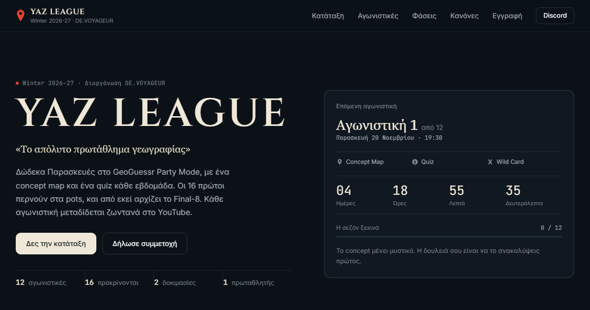

# YAZ LEAGUE · Winter 2026-27

**The official website and admin panel for YAZ LEAGUE — a geography league hosted by DE.VOYAGEUR.**

A dependency-free static front end (HTML / CSS / vanilla JavaScript) backed by Supabase, deployed automatically from GitHub to Netlify.

[](https://yaz-league.netlify.app)
[](https://supabase.com)
[](LICENSE)
[](https://github.com/RealDCLN/yaz-league/actions/workflows/validate.yml)

[Live site](https://yaz-league.netlify.app) · [Admin panel](https://yaz-league.netlify.app/admin) · [Security policy](SECURITY.md) · [Ελληνικά](docs/OPERATIONS.el.md)



---

## Overview

YAZ LEAGUE is a 12-matchday GeoGuessr competition. Every matchday combines a **Concept Map** with a **geography quiz**; the top 16 players qualify for four groups and an eight-player knockout bracket.

The site publishes the live standings, matchday results, player profiles, X2 multipliers, the group stage and the Final-8 bracket. A separate admin panel handles result entry, registrations, multipliers and the knockout phase.

The public site and league content are in Greek; the codebase and this README are in English.

### Season format

| | |
|---|---|
| **Season** | Winter 2026-27 |
| **Matchdays** | 12 (Fridays at 19:30 Europe/Athens; one Thursday exception) |
| **Platform** | GeoGuessr Party Mode + live YouTube broadcast |
| **Qualification** | Top 16 → 4 pots → 4 groups → Final-8 |
| **Final** | 1v1 GeoQuiz (quarter-finals, semi-finals, final + third-place match) |

Each matchday:

1. **Concept Map** — ~25 locations sharing a hidden concept. The top 10 score **12, 10, 8, 7, 6, 5, 4, 3, 2, 1** points. The first player to identify the concept gets **+3**.
2. **Geography Quiz** — 25 questions, same points scale.
3. **Wild Card** — the player with the most combined points (map + quiz) that matchday earns one wild card. Tied leaders all receive one.

Maximum per matchday: **27 points** (12 + 12 + 3).

### X2 multipliers

- **Patreon VIVRE CARD:** one X2 in December and one in January.
- **Holiday matchdays (25/12 & 01/01):** two randomly drawn players receive an X2.
- An X2 doubles the **whole matchday** (map + quiz + concept bonus).
- One X2 per player per matchday.

---

## Features

- **Live leaderboard** with deterministic tie-breaking (points → wild cards → concept bonus → best matchday → map + quiz → name).
- **Matchday results** with concept bonus, X2 multipliers and wild cards.
- **Player profiles** with season totals, placements, form and a rank-progress chart.
- **Season 1 archive** linked to current player profiles by normalized username.
- **Group stage and Final-8 bracket**, including the draw from four pots.
- **Public registration form** with client-side and database-level validation.
- **Admin panel** for matchdays, X2/Patreon, groups/bracket, registrations, players and result history.
- **Demo mode** that runs the full season from a deterministic seed when Supabase is not configured.
- **Responsive, accessible UI** with no framework and no build step.
- **Hardened deployment**: CSP, SRI-pinned CDN scripts, security headers and an admin route excluded from search engines.

---

## Design notes

The visual language is an editorial, map-inspired match-night programme: paper and ink, one pin-red accent, and numbers set in columns.

- **Type:** IBM Plex Serif for headings and Greek copy, Inter for body text, JetBrains Mono for numerals and metadata, Cinzel for the wordmark.
- **Palette:** ink `#0B1117`, surface `#101821`, paper `#EFE7D7`, pin red `#E5432F`.
- **Restraint:** no gradients, glows or coloured shadows; the red is reserved for the next-match card and the leaderboard.
- **Geography:** the dot-matrix world map and topographic contour lines are SVG mask sources, recoloured by CSS.
- **Accessibility:** skip link, semantic landmarks, visible focus states, `prefers-reduced-motion` support and ARIA labels on charts, dialogs and live regions.

---

## Tech stack

| Layer | Technology |
|---|---|
| Front end | HTML5, CSS3, vanilla JavaScript (ES2020), no framework, no build step |
| Data & auth | Supabase (PostgreSQL, PostgREST, Supabase Auth) |
| Charts | Chart.js 4.4.1 (pinned, SRI) |
| Hosting | Netlify (static publish + redirects + headers) |
| CI | GitHub Actions (JavaScript syntax, `.env` and service-role guards) |

---

## Architecture

```text
Browser
├── index.html / admin.html / 404.html
├── css/                    design system and page styles
├── js/config.js            runtime configuration (schedule, scoring, links)
├── js/data.js              Supabase or demo data layer
├── js/stats.js             pure ranking, multiplier and bracket calculations
├── js/app.js               public page rendering
├── js/admin.js             admin panel
├── js/seed.js              deterministic demo season
└── js/history.js           static Season 1 archive
        │
        │ HTTPS (PostgREST + Auth)
        ▼
Supabase
├── players, matches, results
├── registrations, multipliers
├── group_members, phase_matches
└── admins (server-side allowlist)
```

- `js/config.js` is the single place for season dates, scoring, league format and external links.
- `js/stats.js` contains no DOM code, so it can be reused and tested independently.
- `js/data.js` falls back to `js/seed.js` when Supabase is not configured; the rest of the app does not need to know which mode is active.
- The public page reads only non-sensitive player fields. Private registration data is only available to an authenticated admin.

### Data model

| Table | Purpose |
|---|---|
| `players` | Public username (`first_name`), private name (`nickname`), birth year, city, Patreon flag |
| `matches` | One row per matchday and discipline (`map` / `quiz`) |
| `results` | Placement, base points, raw score and concept bonus |
| `registrations` | Pending public sign-ups, readable only by the admin |
| `multipliers` | X2 awards and the matchday they are used on |
| `group_members` | Group draw result and pot/seed |
| `phase_matches` | Group matches, quarter-finals, semi-finals, final and third-place match |
| `admins` | Email allowlist used by `public.is_admin()` |

Computed values — effective points, wild cards and standings — are derived at read time rather than stored twice.

---

## Security model

The repository is intended to be public. Security relies on database rules, not on hiding the front end.

- The Supabase **publishable/anon key** in `js/config.js` is public by design. It can only read data allowed by Row Level Security and column-level grants.
- **RLS is enabled on every table.** The `admins` allowlist table is not readable with the anon key.
- **Column grants** limit anonymous access to `id, first_name, joined_at, is_active, is_patreon` on `players`. Private fields (`nickname`, `birth_year`, `city`) are admin-only.
- **Admin access is enforced server-side.** `public.is_admin()` compares the verified JWT email against `public.admins`; the browser cannot grant itself the role.
- **Registration hardening:** the public form can only insert pending registrations, and a database trigger rate-limits requests to 5 per 15 minutes per hashed IP.
- **CSP and SRI:** `netlify.toml` sets a restrictive Content Security Policy and every CDN script uses a pinned version with a Subresource Integrity hash.
- **No service-role key** is present in the repository or the front end. The service-role/secret key must remain server-side only.
- `/admin` is excluded from search engines with `X-Robots-Tag` and `robots.txt`.

If you find a vulnerability, please follow [SECURITY.md](SECURITY.md) and report it privately rather than opening a public issue.

---

## Local development

No installation or build step is required.

```bash
git clone https://github.com/RealDCLN/yaz-league.git
cd yaz-league
python -m http.server 8080
```

Then open <http://localhost:8080>. Opening `index.html` directly also works.

### Demo mode

Leave `supabaseUrl` and `supabaseAnonKey` empty in `js/config.js` to run the deterministic demo season: 24 players, 12 matchdays, X2 multipliers, groups and a completed Final-8. The registration form shows success but does not persist anything.

The checked-in configuration points at the live Supabase project. To preview demo mode without touching the deployed configuration, temporarily blank those two values (and restore them afterwards).

### Validation

```bash
for file in js/*.js; do node --check "$file"; done
```

The same check runs in GitHub Actions on every push to `main` and every pull request. The workflow also fails if a `.env` file is tracked or a service-role key appears in client code.

---

## Configuration

Everything the site needs at runtime lives in `js/config.js`:

```js
schedule: [
  { week: 1, date: '2026-11-20T19:30:00+02:00' },
  // ...
  { week: 3, date: '2026-12-03T19:30:00+02:00', label: 'Πέμπτη' },
  { week: 6, date: '2026-12-25T19:30:00+02:00', holiday: true },
  { week: 7, date: '2027-01-01T19:30:00+02:00', holiday: true }
]
```

- `points`, `conceptBonus`, `multiplier` and `format` control scoring and league structure.
- `links` holds the Discord, TikTok, YouTube, Instagram and Patreon destinations.
- `links.patreon` may stay empty; the site then shows a Discord prompt instead of a broken link.
- Player names are displayed in uppercase (enforced by both the client and a database trigger).

---

## Supabase setup

1. Create a project at [supabase.com](https://supabase.com).
2. Open **SQL Editor → New query**, paste the entire [`supabase/schema.sql`](supabase/schema.sql) and run it. The schema is idempotent and includes tables, constraints, indexes, RLS, grants, triggers and the admin allowlist.
3. Create the admin user under **Authentication → Users**, then add the email to the allowlist:

   ```sql
   insert into public.admins (email) values ('you@example.com');
   ```

4. Copy **Project URL** and the **publishable/anon key** from **Project Settings → API** into `js/config.js`. If you use a different Supabase project, also update the two Supabase hosts in the `connect-src` directive of the CSP in `netlify.toml`.
5. Optionally run [`supabase/seed.sql`](supabase/seed.sql) on an empty database for demo data.

Existing installations can also run [`supabase/migrations/008_admin_allowlist.sql`](supabase/migrations/008_admin_allowlist.sql) once. It moves the previous hardcoded admin into the allowlist before replacing `is_admin()`.

> Never place a `service_role` / secret key in the front end, `js/config.js` or the repository.

---

## Admin panel

The panel is available at `/admin` and authenticates through Supabase Auth. Only emails in `public.admins` can use it.

- **Matchday** — choose a matchday, enter the Concept Map and Quiz rankings, mark the single concept bonus, preview the result and save. Existing matchdays open for correction.
- **X2 & Patreon** — toggle Patreon status, assign December/January X2 weeks and draw the two holiday multipliers.
- **Phases** — draw the four groups from the pots, enter 1v1 scores and advance the bracket. Changing an earlier round clears later rounds to avoid stale results.
- **Registrations** — approve or reject pending sign-ups; approval creates a player.
- **Players** — manage public usernames, private names, birth years, cities and Patreon status.
- **History** — open or delete both disciplines of a matchday.

Full Greek documentation for the organizer is in [`docs/OPERATIONS.el.md`](docs/OPERATIONS.el.md).

---

## Deployment

Netlify is connected to the GitHub repository and deploys every push to `main`.

`netlify.toml` publishes only the site files:

```toml
command = "rm -rf dist && mkdir -p dist && cp index.html admin.html 404.html robots.txt dist/ && cp -R assets css js dist/"
publish = "dist"
```

README, SQL, `.env`, docs and helper scripts stay in the repository but are never copied to the public directory. The same file also defines the `/admin` redirect and security headers.

---

## Project structure

```text
yaz-league/
├── index.html                     Public site
├── admin.html                     Admin panel (/admin)
├── 404.html
├── robots.txt
├── netlify.toml                   Build, redirects, security headers
├── js/
│   ├── config.js                  Season dates, links, scoring, format
│   ├── history.js                 Season 1 archive + player matching
│   ├── seed.js                    Deterministic demo season
│   ├── stats.js                   Standings, wild cards, X2, groups, bracket
│   ├── data.js                    Supabase or demo data layer
│   ├── app.js                     Public page
│   └── admin.js                   Admin panel
├── css/
│   ├── styles.css                 Public site
│   ├── admin-base.css             Admin design tokens and primitives
│   └── admin.css                  Admin panel
├── assets/                        Favicon, social image, SVG patterns
├── supabase/
│   ├── schema.sql                 Full schema (source of truth)
│   ├── seed.sql                   Demo data
│   └── migrations/
│       └── 008_admin_allowlist.sql
├── docs/
│   └── OPERATIONS.el.md           Greek organizer documentation
├── scripts/
│   └── git-push.bat               Windows commit + push helper
├── .github/
│   ├── workflows/validate.yml
│   ├── ISSUE_TEMPLATE/
│   ├── PULL_REQUEST_TEMPLATE.md
│   ├── CODEOWNERS
│   └── dependabot.yml
├── .editorconfig
├── .gitattributes
├── .gitignore
├── .env.example
├── CONTRIBUTING.md
├── CODE_OF_CONDUCT.md
├── SECURITY.md
├── LICENSE
└── README.md
```

---

## Season 1 archive

Season 1 results are static in [`js/history.js`](js/history.js); no database tables are required. Ranks 1–4 are stored in order, while ranks 5–20 are stored as unordered bands. Current profiles are matched by normalized username, with an `ALIASES` map for small name changes.

---

## Contributing

Contributions, bug reports and documentation fixes are welcome. See [CONTRIBUTING.md](CONTRIBUTING.md) and [CODE_OF_CONDUCT.md](CODE_OF_CONDUCT.md) before opening an issue or pull request.

---

## License

The source code is available under the [MIT License](LICENSE).

Logos, artwork, player names and league content are not covered by the license.

---

Built by [DCLN](https://github.com/RealDCLN) for **DE.VOYAGEUR**.
